# NASA Lab

### The live universe, built from NASA's open data.

Fly from today's Earth, wrapped in the satellites overhead right now, to this month's solar storms, the rocks sliding past us, the surfaces of the Moon, Mars and Vesta, and every planet ever found around another star. **Nothing here is a mock-up.** Every point, orbit and photograph comes live from one of the 16 API families in the [api.nasa.gov](https://api.nasa.gov/) catalogue.

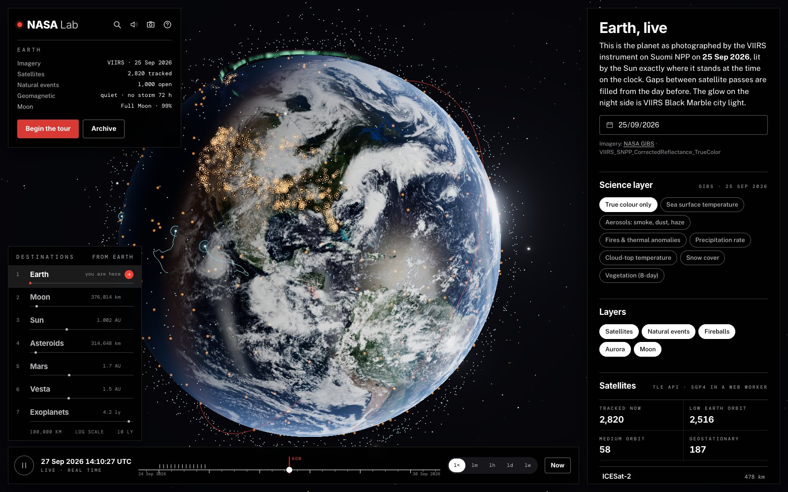

---

## By the numbers

*A snapshot from 27 September 2026. Every figure is fetched live when you open the app, so yours will be different.*

| | | |
|---:|:--|:--|
| 🛰️ **2,820** | satellites tracked in real time | 2,516 in low Earth orbit, 187 geostationary, propagated with SGP4 every frame |
| 🔥 **1,000** | natural events still unfolding | 980 wildfires, 9 volcanoes, 8 severe storms, 3 sea-and-lake-ice events (EONET) |
| ☀️ **14** | solar flares in the last 30 days | strongest M3.0, with **86** coronal mass ejections; the fastest left the Sun at **1,586 km/s** |
| ☄️ **33** | asteroid close approaches in the next 60 days | nearest: 2025 UK9 at **0.82 lunar distances** on 31 Oct 2026 |
| 🪨 **31** | near-Earth objects passing this week | 4 classed as potentially hazardous (NeoWs) |
| 🎯 **2,207** | objects on JPL's Sentry impact-monitoring list | all rated below the background impact risk |
| 💥 **400** | fireballs, small asteroids exploding in the atmosphere | the most recent 400, back to June 2015, each mapped where it burst |
| 🪐 **6,372** | confirmed exoplanets in 4,779 systems | nearest **4.24 light-years** away; 1,504 found in 2016 alone |
| 🌍 **28** | temperate, Earth-sized worlds | under 1.6 Earth radii, getting 0.35–1.5× Earth's sunlight |
| 📷 **13** | EPIC photographs of the whole sunlit Earth | taken a million miles away in a single day |
| 🌌 **1995** | first Astronomy Picture of the Day | 30+ years of APOD, any day on demand |

---

## Take a tour

### Earth, live

The globe carries the most recent full day of imagery from the VIIRS camera on Suomi NPP, with gaps between passes filled from the day before. It is lit by the Sun exactly where it stands at the time on the clock, and NASA's Black Marble city lights glow on the night side.

- **Satellites:** about 2,800 move in real time, propagated in a Web Worker from their latest two-line element sets. Click one to see its orbit and live altitude, or to predict when it next passes over *you*.
- **Natural events:** EONET events pulse where they are happening, and storms trail their recorded tracks.
- **Aurora:** ovals sized by DONKI's latest geomagnetic storm glow at both poles.
- **Science layers:** swap in sea-surface temperature, aerosols, fires, rainfall, cloud-top temperature, snow or vegetation from GIBS. You can pick any day back to November 2015.

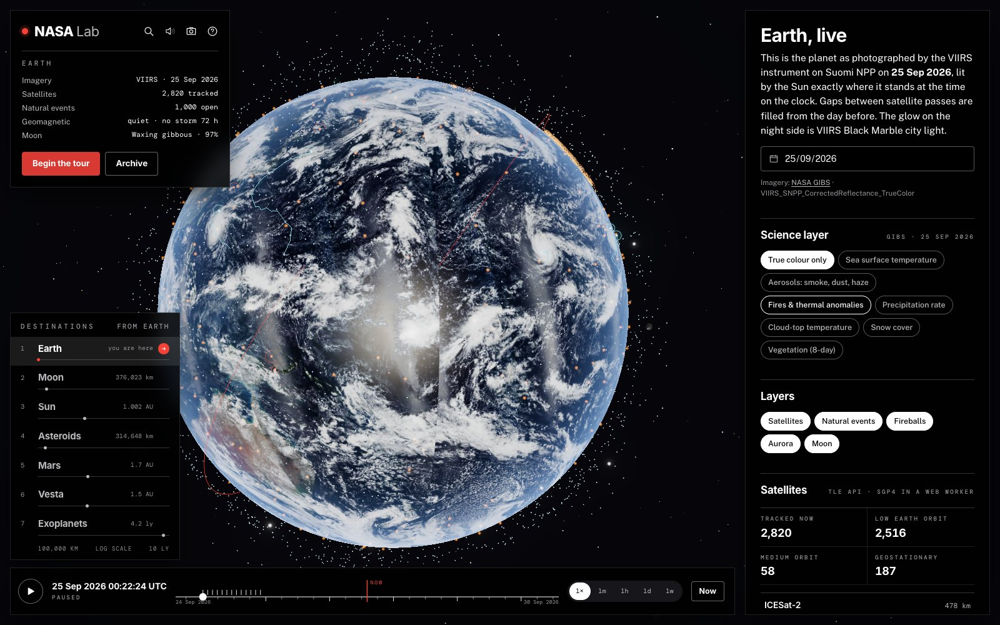

**Match the photograph.** Press *Match this photo* and the clock jumps to the moment NASA's EPIC camera took its latest picture from the L1 point, a million miles away. The camera flies to DSCOVR's line of sight, so the 3-D globe and the real photograph line up. *Play the day* runs all of that day's frames as a time-lapse.

### The Sun, this month

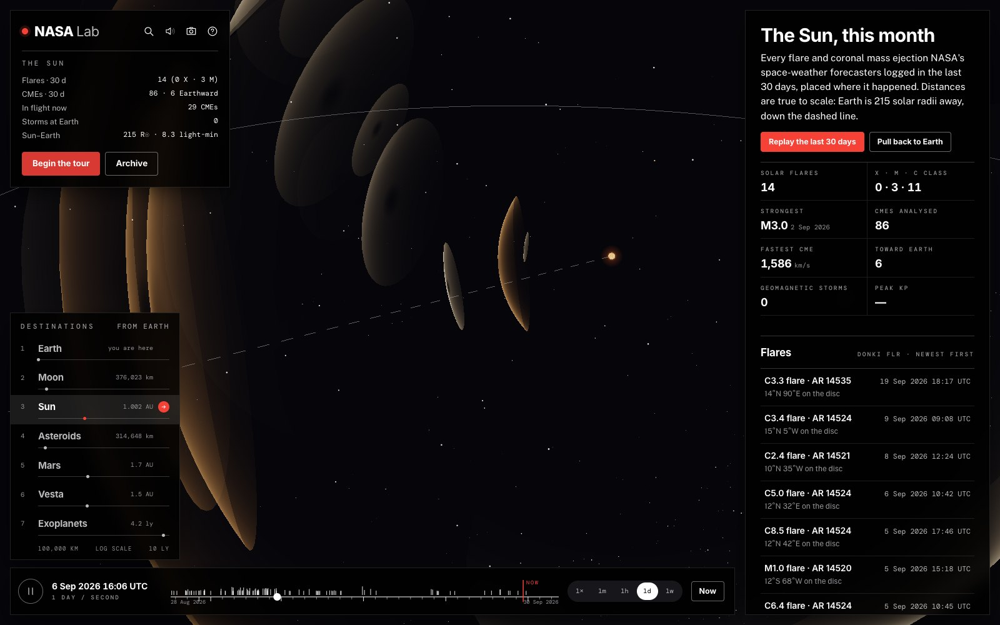

Every flare DONKI's forecasters logged in the last 30 days sits where it erupted on the disc, carried round by the Sun's differential rotation. Every coronal mass ejection flies outward as an expanding shell at its measured speed, direction and width.

It is all **at true scale**: Earth is the blue dot 215 solar radii away, down the dashed line. *Replay the last 30 days* runs a month at a day per second. With sound on, every flare rings out, pitched by its strength.

### Asteroids

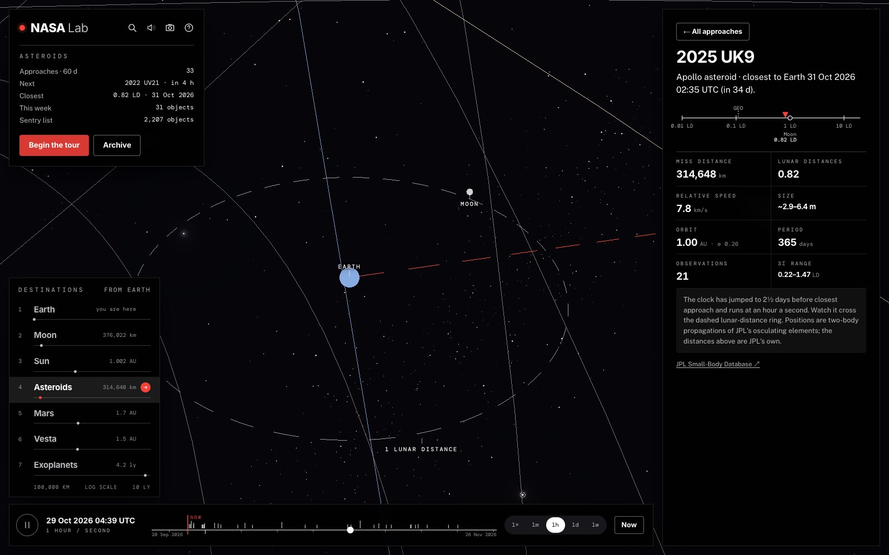

Every asteroid JPL predicts will pass within 0.05 AU in the next 60 days flies along its own orbit, propagated from full-precision orbital elements. The orbits reproduce JPL's own miss distances to within a few percent (under 1% for well-observed asteroids).

Pick one and the clock jumps to just before closest approach. You watch it cross the dashed lunar-distance ring, with the real Moon in its real place. Alongside are this week's NeoWs list and JPL's Sentry impact-risk table, with the probabilities explained in plain language.

### The Moon, Mars and Vesta

<table>
<tr>
<td>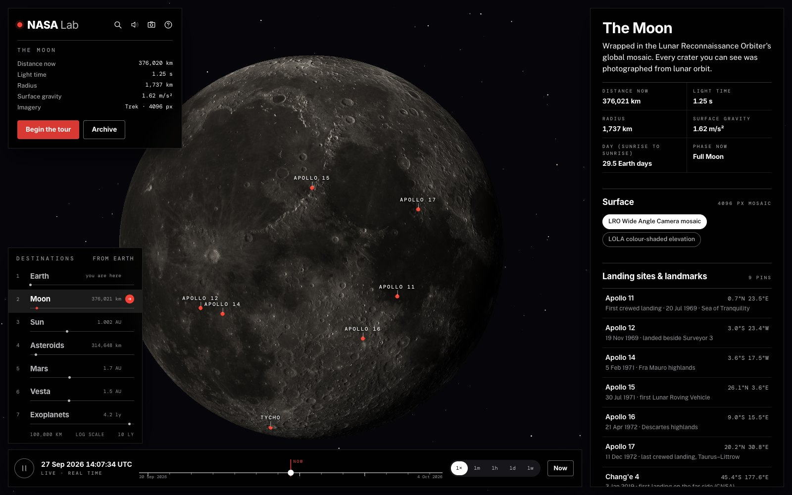</td>
<td>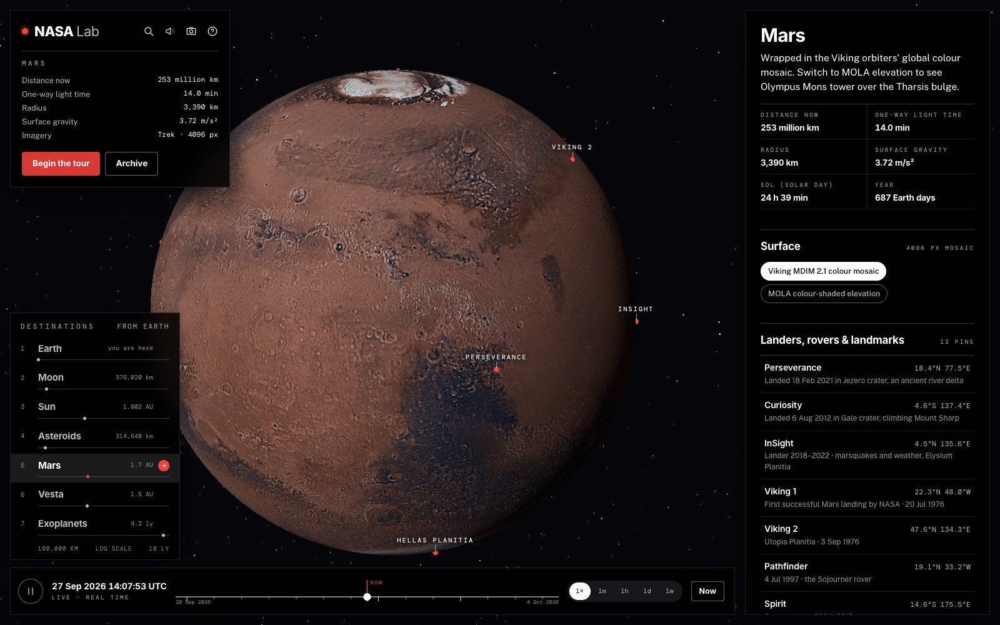</td>
<td>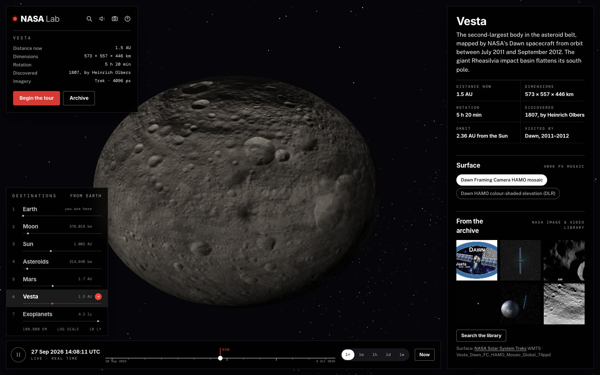</td>
</tr>
</table>

Global mosaics from NASA's Solar System Treks are stitched tile by tile onto each world: LRO for the Moon, Viking and MOLA elevation for Mars, and Dawn for Vesta, which is drawn in its true lumpy shape.

- **Pins** mark every Apollo landing site, every Mars lander and rover, and the great landmarks.
- **Mars** shows InSight's last week of weather reports from Elysium Planitia.
- **Distances** to each world update live.

### Exoplanets

<table>
<tr>
<td width="55%">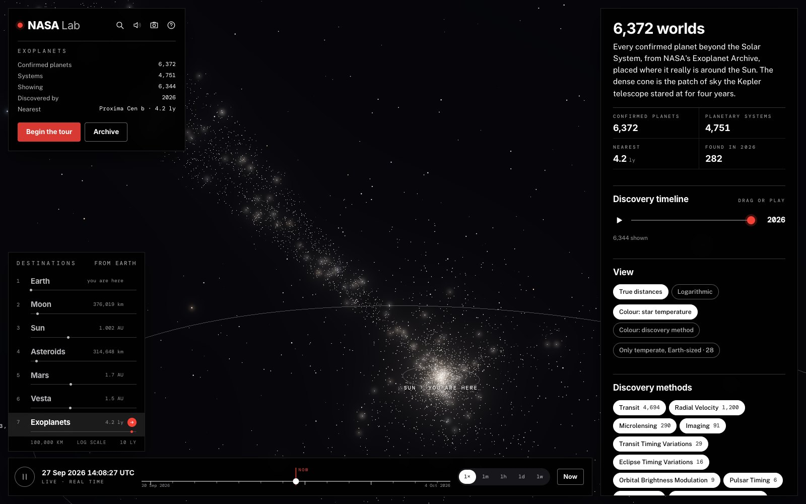</td>
<td width="45%">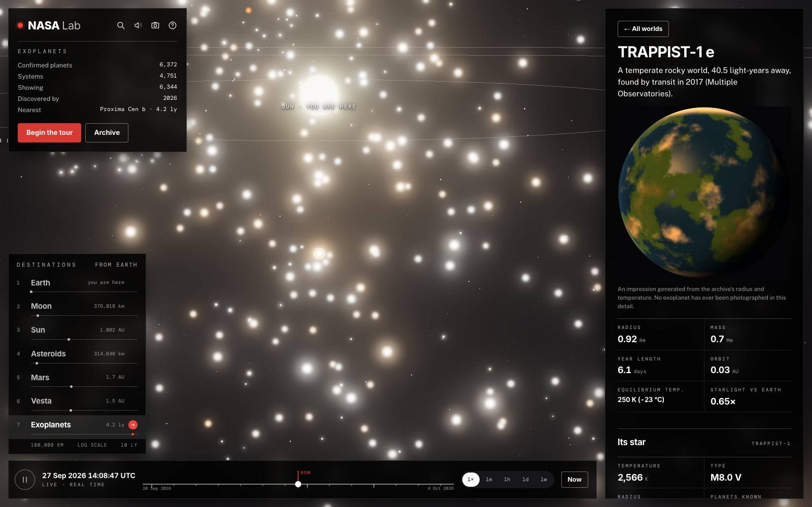</td>
</tr>
</table>

All 6,372 confirmed planets sit at their real positions around the Sun. The long bright stream is the patch of sky the Kepler telescope stared at for four years.

- **Discovery timeline:** press play to watch 30 years of discoveries light up, one chime per year.
- **Views:** switch between true and logarithmic distance, and colour stars by temperature or by how each planet was found.
- **Filters:** show only the temperate, Earth-sized worlds.
- **Close-ups:** click any planet for a close-up generated from its radius and temperature, clearly labelled as an impression.

### The Archive

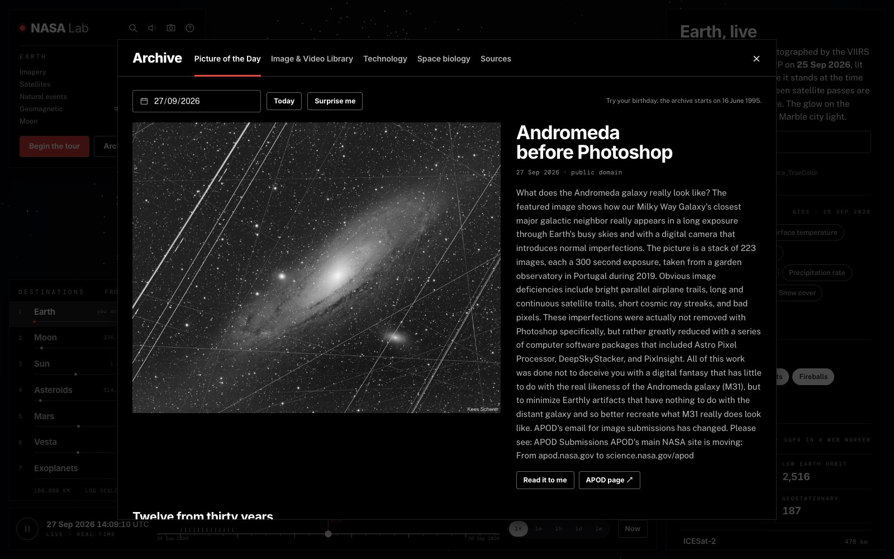

- **Astronomy Picture of the Day** for any date back to 16 June 1995: try your birthday. *Read it to me* narrates the explanation.
- **The NASA Image & Video Library**, with voice search.
- **NASA patents, software and spinoffs**, plus TechPort projects with readiness gauges.
- **Space-biology experiments** from the Open Science Data Repository.
- **A live health board** for every data source.

### On your phone

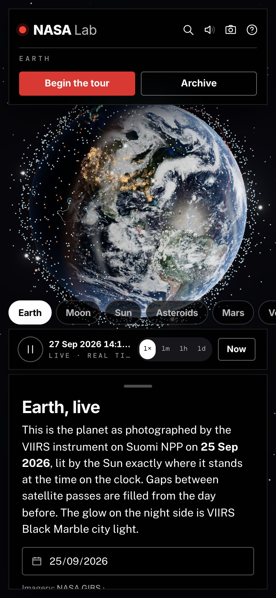

The same universe fits in your pocket: a swipeable destination strip, a bottom sheet for details, and touch to orbit and pinch to zoom.

---

## 🔑 You'll want a NASA API key

**NASA Lab runs without one, but to get the most out of it you need a free API key from [api.nasa.gov](https://api.nasa.gov/).**

Four of its data sources go through `api.nasa.gov` itself:
- the Astronomy Picture of the Day;
- NeoWs (this week's asteroids);
- DONKI (solar flares, CMEs, geomagnetic storms and the aurora);
- the InSight weather archive.

Without a key, the app falls back to NASA's shared `DEMO_KEY`, which allows only **30 requests an hour and 50 a day per IP address**. That runs out quickly, and when it does those sections go quiet. On a host like Vercel it is worse: many sites share the same outgoing addresses, so `DEMO_KEY` may already be spent before your first visitor arrives.

A personal key raises the limit to **1,000 requests an hour**. Because NASA Lab caches and shares responses, that comfortably serves a public site.

**Getting one takes about a minute and costs nothing:**

1. Go to **https://api.nasa.gov/** and fill in the *Generate API Key* form (name and email).
2. Your key appears on screen straight away and is emailed to you.
3. Give it to NASA Lab:
   - **Locally:** put it in `.env` as `NASA_API_KEY=your-key`.
   - **On Vercel:** add `NASA_API_KEY` under *Project → Settings → Environment Variables*, then redeploy.

The key stays on the server. NASA Lab's gateway adds it to requests and scrubs it from every response, so it never reaches a visitor's browser. To confirm it is picked up, visit `/api/health` and look for `"keyConfigured": true`.

The other sources need no key: EONET, EPIC, GIBS, the TLE API, JPL's SSD/CNEOS, the Exoplanet Archive, the Image Library, Trek, TechTransfer, TechPort and OSDR.

---

## Run it locally

Requires Node 20.6 or newer.

```bash
npm install
cp .env.example .env        # then paste your key into NASA_API_KEY
npm run dev                 # gateway on :8787 + Vite on :5173
```

Open http://127.0.0.1:5173.

For a single production process:

```bash
npm run build
npm start                   # serves the built app and the API on http://127.0.0.1:8787
```

`npm run check` smoke-tests every gateway endpoint, and fails if the API key ever appears in a response body.

## Deploy to Vercel

The repo is ready for Vercel as is:
- `vercel.json` builds the Vite app into `dist/`.
- `api/index.js` runs the gateway as a serverless function, and every `/api/*` request is rewritten to it.

Steps:

1. **Import the project.** Push it to GitHub and choose *Add New… → Project* in Vercel, or run `npx vercel` in this folder. Leave the build settings as they are.
2. **Add the key.** In *Project → Settings → Environment Variables*, add:
   - **Key:** `NASA_API_KEY`
   - **Value:** your key from https://api.nasa.gov/
   - **Environments:** Production (and Preview if you like)
3. **Redeploy.** Environment variables only reach new deployments: use *Deployments → ⋯ → Redeploy*.
4. **Check it.** Open `https://<your-app>.vercel.app/api/health`. It should say `"keyConfigured": true`.

**On Vercel:**
- Responses carry `s-maxage`, so Vercel's CDN answers repeat requests and all visitors share one upstream call per cache window.
- The function limit is 60 s, so the slowest feeds are trimmed: the satellite catalogue stops fetching after 40 s, and TechPort shows 12 projects instead of 16.
- `.vercelignore` and `.gitignore` both exclude `.env`.

## Things to try

| Key | Action |
|---|---|
| `T` | **The tour:** ten narrated stops, each written from the live numbers |
| `1`–`7` | Earth, Moon, Sun, Asteroids, Mars, Vesta, Exoplanets |
| Space / `N` | Pause time · back to now (or drag along the time scale) |
| `/` or `⌘K` | Search every satellite, storm, flare, asteroid, landing site and exoplanet |
| `S` | Sound: a drone for each place, and data you can hear |
| `P` | Save the current view as a captioned postcard |
| `A` | Open the Archive |
| `R` · `F` · `?` | Auto-rotate · full screen · help and credits |

## How it's built

- **Three.js with custom GLSL shaders:**
  - Earth's day/night terminator, ocean glint and atmosphere;
  - the Sun's surface;
  - CME shells and aurora curtains;
  - the procedural exoplanet close-ups.
- **satellite.js** runs SGP4 for ~2,800 satellites in a Web Worker, plus pass predictions for your location.
- **Positional astronomy:**
  - planets from JPL's Keplerian elements;
  - the Sun and Moon from Astronomical Almanac formulas;
  - asteroids from full-precision SBDB elements;
  - flare positions carried by the Sun's differential rotation.
- **Web Audio** for a generative score and sonified data, and **Web Speech** for narration and voice search.
- **A small Node gateway** that keeps the API key server-side, proxies services that lack CORS, caches everything, and serves the last good copy if a service stumbles.

```
browser ──► Vite app (static on Vercel's CDN, or served by npm start)
   │           GIBS & Trek imagery come straight from NASA (CORS-enabled tiles)
   └─ /api/* ─► Node gateway (server/app.js — a Vercel function via api/index.js,
                 or a local Express server via server/index.js)
                 • injects the API key server-side and scrubs it from every response
                 • proxies endpoints that lack CORS (JPL SSD, EPIC archive, image assets)
                 • caches responses, dedupes in-flight requests,
                   serves the last good copy when an upstream fails
                 • trims oversized feeds (TechPort, Exoplanet TAP → columnar JSON)
                 • per-client rate limiting
```

### Every source, and where it appears

| Catalogue entry | Endpoint(s) used | Key needed? | Where |
|---|---|:-:|---|
| APOD | `planetary/apod` (date, count) | ✅ | Archive |
| Asteroids NeoWs | `neo/rest/v1/feed`, `neo/{id}` | ✅ | Asteroids |
| DONKI | `FLR`, `CMEAnalysis`, `GST`, `notifications` | ✅ | Sun, Earth aurora |
| InSight | `insight_weather` (archive, mission ended 2022) | ✅ | Mars |
| EONET | `v3/events` | – | Earth |
| EPIC | `api/natural`, archive images | – | Earth |
| Exoplanet Archive | TAP `pscomppars` | – | Exoplanets |
| GIBS | WMS: VIIRS true colour, Black Marble, Blue Marble, 7 science layers | – | Earth |
| Image & Video Library | `search`, `asset` | – | Archive, worlds |
| OSDR | `osdr/data/search` | – | Archive |
| Satellite Situation Center | `WS/sscr/2/locations` | – | Sources board (status only) |
| SSD/CNEOS | `cad`, `sbdb` (full precision), `sentry`, `fireball` | – | Asteroids, Earth |
| TechPort | `projects?updatedSince`, `projects/{id}` | – | Archive |
| TechTransfer | `patent`, `software`, `spinoff` | – | Archive |
| TLE API | popularity-sorted catalogue, search | – | Earth |
| Moon/Mars/Vesta Trek | WMTS tiles | – | Moon, Mars, Vesta |

### What's real and what's drawn

- **Real:**
  - positions, orbits, events, photographs and measurements;
  - every number on screen, which comes from a live feed or a published constant.
- **Drawn:**
  - the background star field (though its Milky Way band follows the real galactic plane);
  - the Sun's granulation;
  - the aurora curtains, placed at the latitude DONKI's latest storm implies, or a quiet level when there is none;
  - enlarged planet and asteroid sizes;
  - the exoplanet close-ups.

  The interface labels each of these where it appears.
- **Workarounds:** TechPort's search does not filter, so the Archive shows its feed of recently updated projects. The Satellite Situation Center refused connections during development, so it appears only on the Sources board.

---

NASA Lab is an independent project built on NASA's open data. It is not affiliated with or endorsed by NASA. Imagery and data are courtesy of NASA, JPL-Caltech, NOAA and the missions credited in the app.
